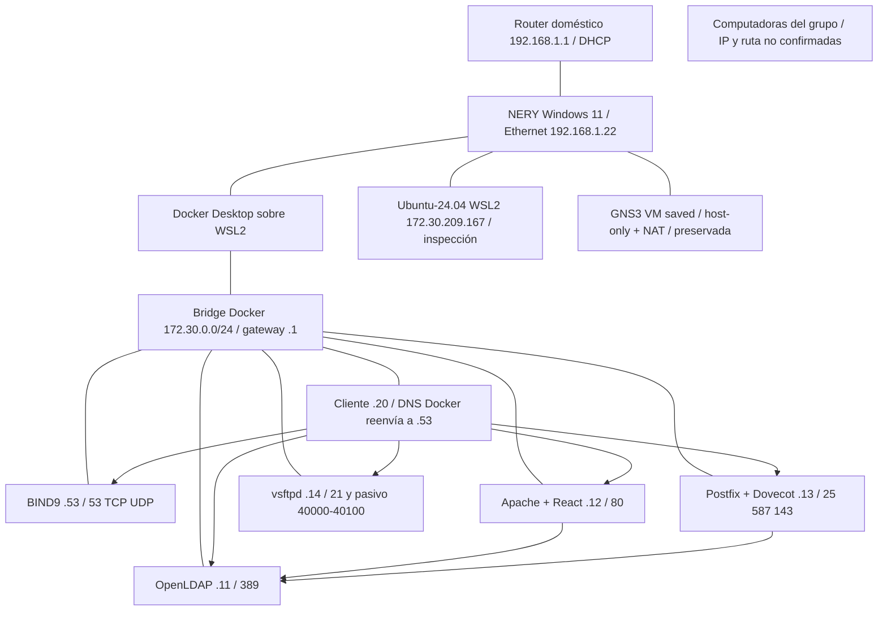

# Arquitectura realmente implementada

Se eligió estrategia C (Docker/WSL2). La VM GNS3 no aporta una ventaja y tiene estado de otro proyecto; crear Ubuntu con 3-4 GiB comprometería la RAM disponible. No se crearon ni modificaron VMs, no se descargó ISO y no se habilitó bridge.

Other no está conectado al diagrama funcional: la ruta hacia el montaje aislado está pendiente. No se demostró un switch del grupo; el router doméstico se infiere del gateway/DHCP observado. Tabla de MAC/IP: tabla-direccionamiento.md.

Los FQDN se resuelven por BIND con zona integration/dns/db.aerolinea.redes.test. El cliente usa el resolvedor interno de Docker 127.0.0.11, que reenvía al DNS .53. No hay entradas del dominio en /etc/hosts. La versión ASCII aerolinea.redes.test mantiene el acuerdo del equipo; el PDF escribe aerolínea.redes.test con tilde. Se requiere validación académica de esta diferencia.

Publicaciones al host: 127.0.0.1:15353 TCP/UDP -> DNS 53, :1389 -> LDAP 389, :8080 -> Apache 80, :2525 -> SMTP 25, :1587 -> submission 587, :1143 -> IMAP 143. FTP solo interno. No se pueden utilizar estas IP Docker como si fueran direcciones LAN de las computadoras.

DNS no requiere LDAP; Apache y correo requieren DNS y LDAP; FTP depende de DNS para su localización. Los volúmenes LDAP data/config, Maildir y FTP sobreviven a recreación. restart:unless-stopped permite recuperación al arrancar Docker; inicio automático de Docker después de reinicio completo de Windows no fue probado.

## Reutilización para AeroQuetzal

BIND/zona, usuarios inetOrgPerson, autenticación Apache, Maildir, control FTP y matriz automatizada son reutilizables con adaptación. La propuesta tiene dos VM Hetzner, ocho zonas VLSM, edge-vpn/core-app, VPN WireGuard, nftables, CoreDNS, DHCP dnsmasq, NTP chrony, Nginx/Astro y LDAP replicado con LDAPS. Requiere nombres/IP propios, TLS, ACL por rol, rotación de secretos, backups externos, monitorización, pruebas de aislamiento y réplicas. FTP/correo sin TLS y el fixture académico no son apropiados para Internet. No se desplegó nada en Hetzner ni se generaron cargos.
