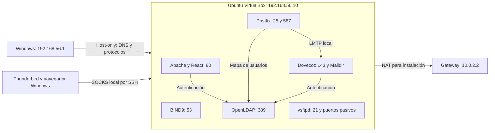

# Laboratorio 5 — Ubuntu nativo en VirtualBox

Servidor: `CC3067-Lab5-Ubuntu`, Ubuntu 24.04.4, 1 CPU, 1536 MB, disco de
25 GiB. Se creó una VM independiente porque GNS3 es un appliance dedicado;
GNS3 permanece en estado guardado. No se usaron Docker ni WSL para alojar
los servicios.

## Red y acceso

| Equipo / interfaz | IPv4 | MAC | Función |
|---|---|---|---|
| Ubuntu enp0s3 | 10.0.2.15/24 | 08:00:27:5c:08:8e | NAT, gateway 10.0.2.2 |
| Ubuntu enp0s8 | 192.168.56.10/24 | 08:00:27:b1:41:d6 | Host-only, IP estática |
| Windows host-only | 192.168.56.1/24 | 0a:00:27:00:00:11 | Cliente independiente |

SSH con usuario `labadmin` y clave privada local; rutas verificadas:
`192.168.56.10:22` y `127.0.0.1:22225`. Las claves y credenciales renovadas
permanecen en `.git/`, fuera del control de versiones. No se cambiaron la
DNS global de Windows, el router ni la interfaz Ethernet 192.168.1.22.

BIND9, OpenLDAP, Apache, Postfix, Dovecot y vsftpd son procesos nativos
administrados por systemd. UFW limita los protocolos a host-only; NAT sólo
redirige SSH a loopback. Postfix rechaza relay externo no autenticado.
La comprobación de actividad usa `postfix@-.service`, que ejecuta el proceso
master, junto con las otras cinco unidades. `postfix.service` es auxiliar;
la espera exige seis líneas exactamente `active`.



## Resultados y evidencia

La [matriz de 33 casos](matriz-pruebas-virtualbox.md) y
[matriz-final.json](evidencias/virtualbox/matriz-final.json) contienen el
resultado definitivo, procedimiento y alcance de cada caso. Los resultados
de Windows usan tráfico real DNS/LDAP/HTTP/SMTP/IMAP/FTP; las herramientas
dnspython y ldap3 sustituyen únicamente las CLI Linux del cliente.
Thunderbird es la aplicación real de Windows, con un perfil exclusivo;
sus pruebas conectan dos cuentas, envían y muestran un mensaje único.

Las capturas se obtuvieron de la aplicación y del sitio React original.
El navegador y Thunderbird resuelven el dominio mediante un proxy SOCKS
local por SSH a Ubuntu. Las pruebas de protocolos consultan BIND desde el
propio proceso, sin modificar la configuración DNS global de Windows.

El primer reinicio produjo un kernel panic de temporizador APIC, conservado
en [reinicio-intento-fallido.log](evidencias/virtualbox/reinicio-intento-fallido.log).
Se configuró GRUB con `quiet noapic clocksource=acpi_pm` únicamente en esta VM.
La prueba INT-02 exige un `systemctl reboot` real, cambio de boot ID,
recuperación automática de seis servicios, las mismas IP/MAC y SHA256 de
los archivos anteriores de Maildir/FTP. Después repite los 26 casos de
protocolos desde Windows; no aprueba el reinicio mediante un encendido manual.
El fallo inicial de lectura IMAP se conserva en
`resultados-windows-regresion-fallida.json`; la prueba usa ahora UID y
extrae los cuerpos de las respuestas FETCH sin asumir una posición fija.

Se conservan los snapshots `Ubuntu-inicial-SSH` y
`Lab5-servicios-persistentes`. Este último se tomó con la VM apagada;
un intento en vivo que no terminaba fue cancelado antes. Los nombres y UUID
figuran en `snapshots.txt`. El segundo snapshot guarda disco y configuración,
sin estado de memoria de ejecución.

Las fuentes e instaladores reproducibles están en [virtualbox](../virtualbox/README.md).
El [reporte nativo](reporte/Laboratorio_5_Redes_VirtualBox.pdf) se incorpora
al [PDF de entrega](reporte/Laboratorio_5_Redes_Entrega.pdf). El
[reporte anterior](reporte/Laboratorio_5_Redes_Antecedente_Docker.pdf)
se conserva íntegro como antecedente separado de los resultados nativos.

## Volver a usar el laboratorio

Desde PowerShell, en el repositorio:

```powershell
powershell -ExecutionPolicy Bypass -File virtualbox/iniciar-vm.ps1
powershell -ExecutionPolicy Bypass -File virtualbox/iniciar-cliente.ps1
powershell -ExecutionPolicy Bypass -File virtualbox/abrir-web.ps1
```

`iniciar-vm.ps1` espera SSH y seis servicios activos. Para entrar por SSH:
`powershell -ExecutionPolicy Bypass -File virtualbox/conectar-ssh.ps1`.
Dentro de Ubuntu: `sudo bash /opt/lab5/virtualbox/verificar-servicios.sh`.
Para apagar normalmente: `powershell -ExecutionPolicy Bypass -File virtualbox/detener-vm.ps1`.

## Límites y pendientes

Windows y Ubuntu son sistemas independientes en el mismo equipo físico.
No hay otro equipo del grupo disponible: las pruebas entre computadoras
físicas siguen pendientes. Host-only no demuestra acceso desde la LAN.
No se configuró bridge ni se publicaron servicios hacia Internet.

[npm-audit.json](evidencias/virtualbox/npm-audit.json) registra siete alertas
altas en dependencias de desarrollo de shadcn. No se aplicó el cambio de
versión incompatible propuesto por npm. Apache sirve la compilación estática;
los 33 casos de redes no constituyen una auditoría de esas dependencias.
Se actualizaron los paquetes necesarios durante la instalación, sin afirmar
que todos los paquetes del sistema estén actualizados.
